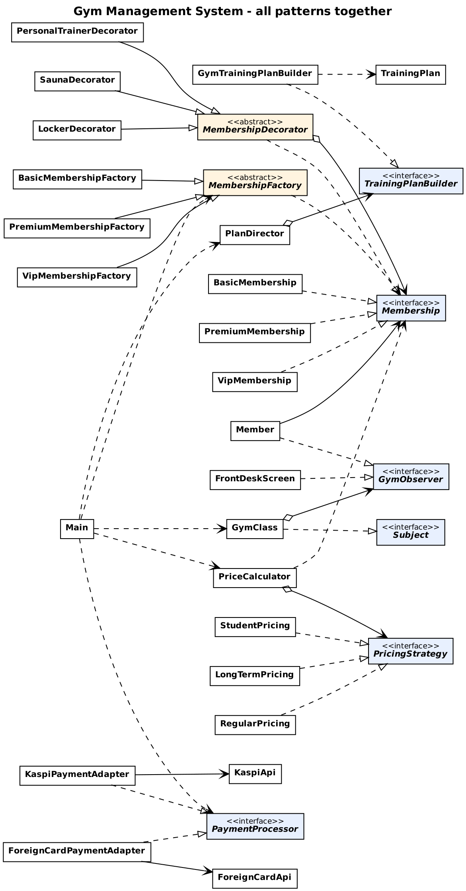
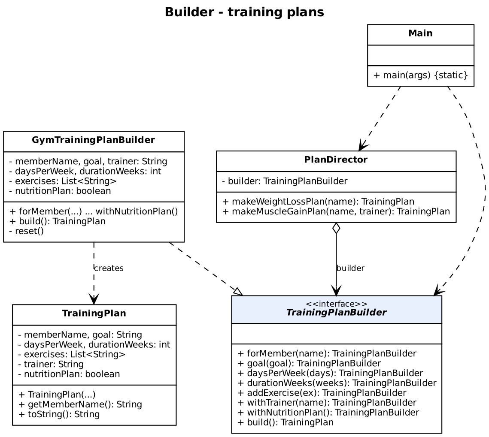
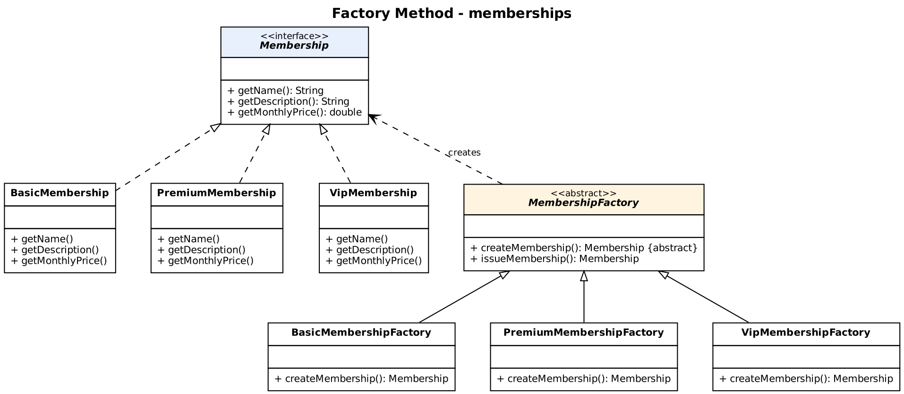
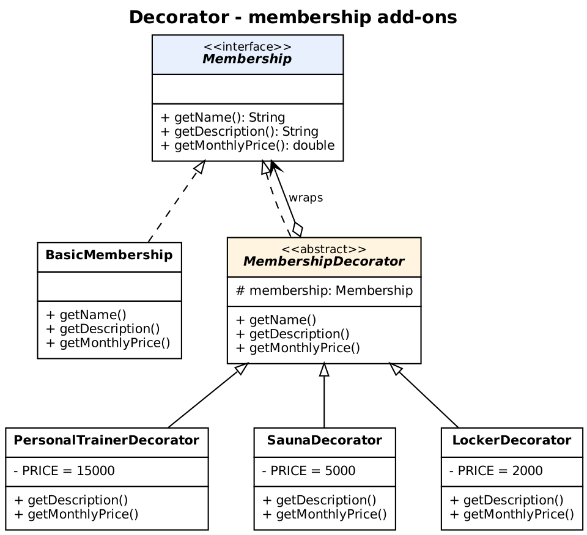
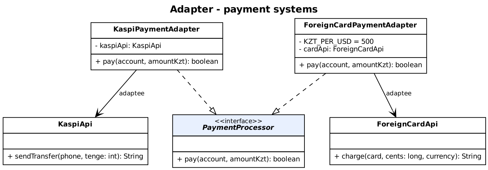
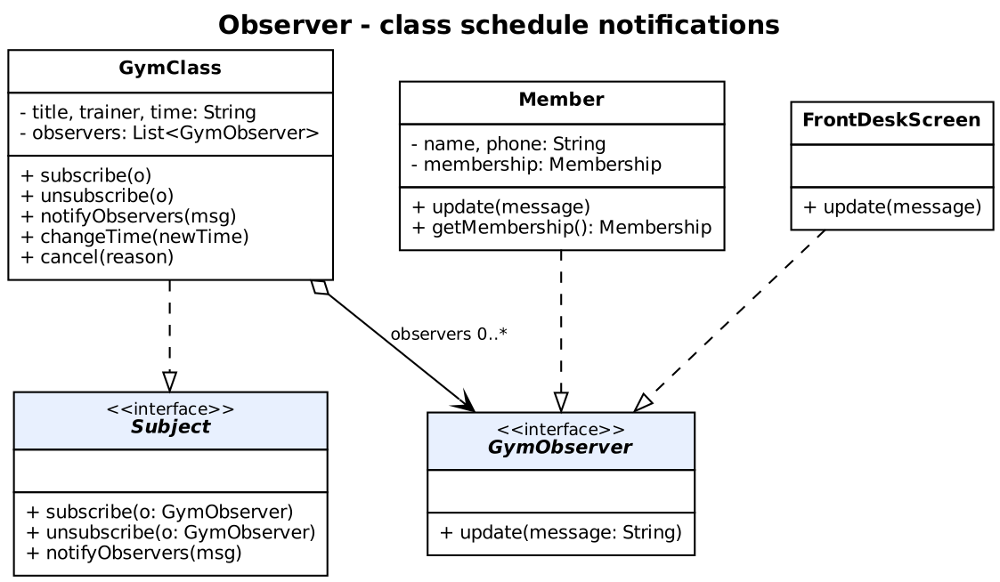
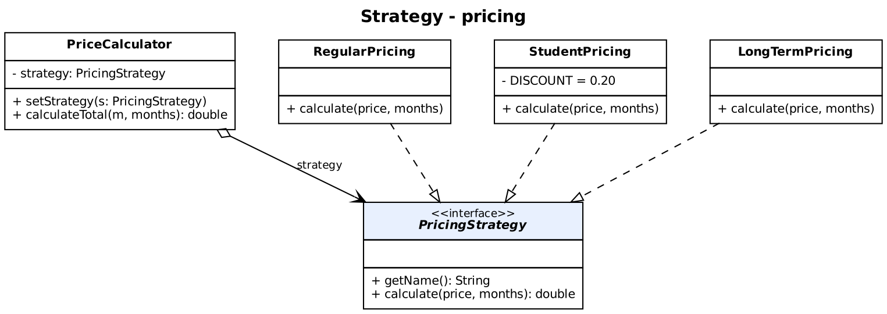
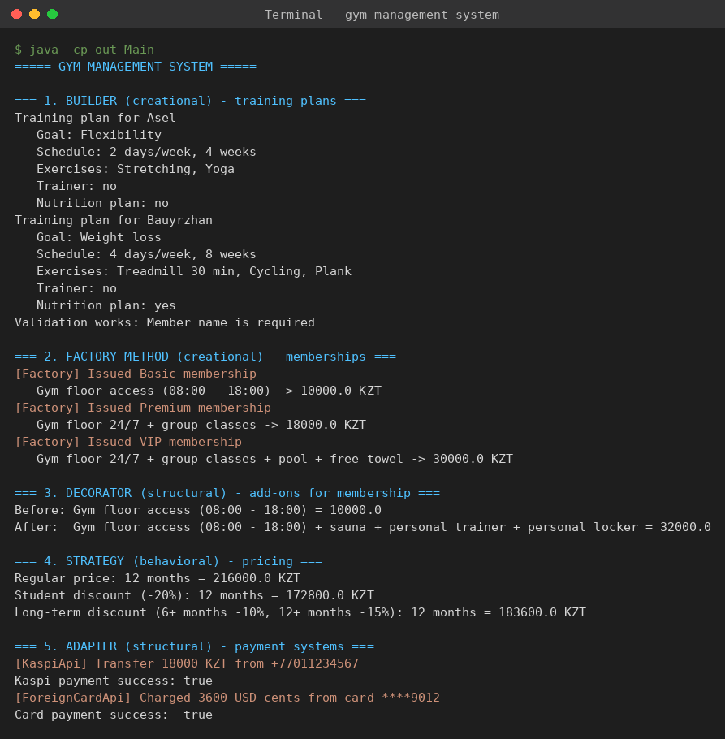
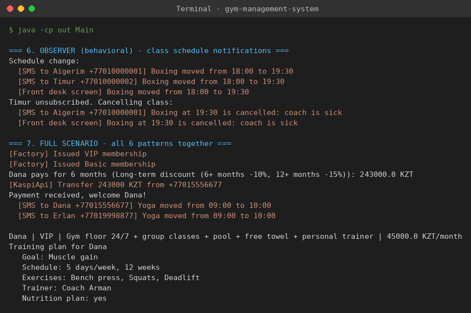

**Repository:** https://github.com/alitulindinov/gym-management-system

**Language:** Java 17+ (console application, no external libraries)

| Student | Pattern 1 | Pattern 2 | Pattern type |
|---|---|---|---|
| Kaisar | Builder | Factory Method | Creational |
| Darkhan | Decorator | Adapter | Structural |
| Ali | Observer | Strategy | Behavioral |

# 1. Introduction

A gym has to manage many things at the same time: members and their memberships, extra services (personal trainer, sauna, locker), different prices and discounts, payments through different payment systems, and a schedule of group classes that sometimes changes.

The goal of our project is to build a small **Gym Management System** in Java and to show how classic GoF design patterns help to keep such a system simple, flexible and easy to extend. According to the project requirements, every team member implemented two patterns, and together the team integrated **six distinct patterns** into one working program:

- **Creational:** Builder, Factory Method
- **Structural:** Decorator, Adapter
- **Behavioral:** Observer, Strategy

All patterns are placed in their own packages, and the only class outside of these packages is `Main`, which tests every pattern separately and then runs one full scenario where all six patterns work together.

# 2. Body

## 2.1 Project structure

Each pattern has its own package, and inside the package the sub-folders follow the roles of the pattern (product/creator, target/adaptee/adapters, subject/subscriber, context/strategies).

```
src/
├── Main.java  (only class outside packages)
├── builder/
│   ├── product/   TrainingPlan
│   ├── builders/  TrainingPlanBuilder,
│   │              GymTrainingPlanBuilder
│   └── director/  PlanDirector
├── factory/
│   ├── product/   Membership + Basic/Premium/Vip
│   └── creator/   MembershipFactory + 3 factories
├── decorator/
│   ├── base/      MembershipDecorator
│   └── addon/     PersonalTrainer/Sauna/Locker
├── adapter/
│   ├── target/    PaymentProcessor
│   ├── adaptee/   KaspiApi, ForeignCardApi
│   └── adapters/  Kaspi/ForeignCard adapters
├── observer/
│   ├── subject/   Subject, GymClass
│   └── subscriber/ GymObserver, Member,
│                   FrontDeskScreen
└── strategy/
    ├── context/   PriceCalculator
    └── pricing/   PricingStrategy + Regular/
                   Student/LongTerm
```

## 2.2 How the patterns work together

{width=100%}

The typical flow of registering a new member is:

1. **Factory Method** creates a membership object (Basic, Premium or VIP).
2. **Decorator** wraps this membership with extra services; each wrapper adds to the description and the price.
3. **Strategy** calculates the final price for N months (regular, student or long-term discount).
4. **Adapter** lets the member pay with Kaspi or with a foreign card through one common `PaymentProcessor` interface.
5. **Builder**: a `PlanDirector` with a `GymTrainingPlanBuilder` creates a personal training plan for the new member step by step.
6. **Observer**: the member subscribes to a group class (`GymClass`); when the time changes or the class is cancelled, all subscribers get a notification.

The patterns interact directly: decorators wrap objects created by the factory, the price calculator works with decorated memberships, `Member` (an observer) holds a `Membership`, and the training plan is built for a member who was created with the factory.

## 2.3 Builder — training plans (Kaisar)

**Problem:** a training plan has many fields: member, goal, days per week, duration, a list of exercises, and optional parts — a personal trainer and a nutrition plan. A constructor with 7 parameters is hard to read (`new TrainingPlan("Dana", "Muscle gain", 5, 12, list, null, true)` — what is `null`, what is `true`?), and different plans need different optional parts.

**Solution:** the object is built step by step. `TrainingPlan` is the *product*. `TrainingPlanBuilder` is the *builder* interface with one method per step; every step returns the builder, so the calls can be chained. `GymTrainingPlanBuilder` is the *concrete builder*: it collects the parts, checks them in `build()` (member name is required, days per week 1–7) and then resets itself, so the same builder can be reused. `PlanDirector` is the *director*: it knows the order of steps for ready-made plans (weight loss, muscle gain). A plan can also be built by hand without the director, using only the steps that are needed.

{width=80%}

*File: `src/builder/builders/TrainingPlanBuilder.java`*

```java
package builder.builders;

import builder.product.TrainingPlan;

/**
 * Builder interface - declares the steps to build a TrainingPlan.
 * Every step returns the builder itself, so calls can be chained.
 */
public interface TrainingPlanBuilder {

    TrainingPlanBuilder forMember(String memberName);

    TrainingPlanBuilder goal(String goal);

    TrainingPlanBuilder daysPerWeek(int days);

    TrainingPlanBuilder durationWeeks(int weeks);

    TrainingPlanBuilder addExercise(String exercise);

    TrainingPlanBuilder withTrainer(String trainer);

    TrainingPlanBuilder withNutritionPlan();

    TrainingPlan build();
}
```

*File: `src/builder/builders/GymTrainingPlanBuilder.java`*

```java
package builder.builders;

import builder.product.TrainingPlan;

import java.util.ArrayList;
import java.util.List;

/**
 * Concrete builder - collects the parts and creates the TrainingPlan in build().
 */
public class GymTrainingPlanBuilder implements TrainingPlanBuilder {

    private String memberName;
    private String goal = "General fitness";
    private int daysPerWeek = 3;
    private int durationWeeks = 4;
    private List<String> exercises = new ArrayList<>();
    private String trainer;
    private boolean nutritionPlan;

    @Override
    public TrainingPlanBuilder forMember(String memberName) {
        this.memberName = memberName;
        return this;
    }

    @Override
    public TrainingPlanBuilder goal(String goal) {
        this.goal = goal;
        return this;
    }

    @Override
    public TrainingPlanBuilder daysPerWeek(int days) {
        this.daysPerWeek = days;
        return this;
    }

    @Override
    public TrainingPlanBuilder durationWeeks(int weeks) {
        this.durationWeeks = weeks;
        return this;
    }

    @Override
    public TrainingPlanBuilder addExercise(String exercise) {
        exercises.add(exercise);
        return this;
    }

    @Override
    public TrainingPlanBuilder withTrainer(String trainer) {
        this.trainer = trainer;
        return this;
    }

    @Override
    public TrainingPlanBuilder withNutritionPlan() {
        this.nutritionPlan = true;
        return this;
    }

    @Override
    public TrainingPlan build() {
        if (memberName == null || memberName.isEmpty()) {
            throw new IllegalStateException("Member name is required");
        }
        if (daysPerWeek < 1 || daysPerWeek > 7) {
            throw new IllegalStateException("Days per week must be from 1 to 7");
        }
        TrainingPlan plan = new TrainingPlan(memberName, goal, daysPerWeek, durationWeeks,
                exercises, trainer, nutritionPlan);
        reset(); // the same builder can be used again for the next plan
        return plan;
    }

    private void reset() {
        memberName = null;
        goal = "General fitness";
        daysPerWeek = 3;
        durationWeeks = 4;
        exercises = new ArrayList<>();
        trainer = null;
        nutritionPlan = false;
    }
}
```

*File: `src/builder/director/PlanDirector.java`*

```java
package builder.director;

import builder.builders.TrainingPlanBuilder;
import builder.product.TrainingPlan;

/**
 * Director of the Builder pattern.
 * It knows the ORDER of steps for ready-made plans,
 * the builder knows HOW to build each part.
 */
public class PlanDirector {

    private final TrainingPlanBuilder builder;

    public PlanDirector(TrainingPlanBuilder builder) {
        this.builder = builder;
    }

    public TrainingPlan makeWeightLossPlan(String memberName) {
        return builder.forMember(memberName)
                .goal("Weight loss")
                .daysPerWeek(4)
                .durationWeeks(8)
                .addExercise("Treadmill 30 min")
                .addExercise("Cycling")
                .addExercise("Plank")
                .withNutritionPlan()
                .build();
    }

    public TrainingPlan makeMuscleGainPlan(String memberName, String trainer) {
        return builder.forMember(memberName)
                .goal("Muscle gain")
                .daysPerWeek(5)
                .durationWeeks(12)
                .addExercise("Bench press")
                .addExercise("Squats")
                .addExercise("Deadlift")
                .withTrainer(trainer)
                .withNutritionPlan()
                .build();
    }
}
```

## 2.4 Factory Method — memberships (Kaisar)

**Problem:** the gym has several membership types and new types appear (e.g. “Student”, “Family”). We do not want `if/switch` on the type everywhere in the code.

**Solution:** `Membership` is the *product* interface; `BasicMembership`, `PremiumMembership`, `VipMembership` are concrete products. `MembershipFactory` is the abstract *creator* with the factory method `createMembership()`; each concrete factory overrides it and decides which product to create. The common method `issueMembership()` uses the factory method without knowing the concrete class. A new type = one new product + one new factory, nothing else changes (Open/Closed principle).

{width=100%}

*File: `src/factory/creator/MembershipFactory.java`*

```java
package factory.creator;

import factory.product.Membership;

/**
 * Creator of the Factory Method pattern.
 * Subclasses decide which concrete Membership to create.
 */
public abstract class MembershipFactory {

    // the factory method
    public abstract Membership createMembership();

    // common logic that uses the factory method
    public Membership issueMembership() {
        Membership membership = createMembership();
        System.out.println("[Factory] Issued " + membership.getName() + " membership");
        return membership;
    }
}
```

*File: `src/factory/creator/PremiumMembershipFactory.java`*

```java
package factory.creator;

import factory.product.Membership;
import factory.product.PremiumMembership;

public class PremiumMembershipFactory extends MembershipFactory {

    @Override
    public Membership createMembership() {
        return new PremiumMembership();
    }
}
```

## 2.5 Decorator — membership add-ons (Darkhan)

**Problem:** a member can add any combination of extras: personal trainer, sauna, locker. Making a subclass for every combination (`BasicWithSaunaAndLocker`, ...) would create a class explosion.

**Solution:** `MembershipDecorator` implements `Membership` *and* contains a `Membership` inside. By default it forwards all calls to the wrapped object. Each concrete decorator overrides only `getDescription()` and `getMonthlyPrice()` and adds its own part. Decorators can be stacked at runtime in any order.

{width=85%}

*File: `src/decorator/base/MembershipDecorator.java`*

```java
package decorator.base;

import factory.product.Membership;

/**
 * Base decorator of the Decorator pattern.
 * It implements Membership and also HAS a Membership inside (wrappee).
 * By default it just forwards all calls to the wrapped object.
 */
public abstract class MembershipDecorator implements Membership {

    protected final Membership membership;

    protected MembershipDecorator(Membership membership) {
        this.membership = membership;
    }

    @Override
    public String getName() {
        return membership.getName();
    }

    @Override
    public String getDescription() {
        return membership.getDescription();
    }

    @Override
    public double getMonthlyPrice() {
        return membership.getMonthlyPrice();
    }
}
```

*File: `src/decorator/addon/SaunaDecorator.java`*

```java
package decorator.addon;

import decorator.base.MembershipDecorator;
import factory.product.Membership;

public class SaunaDecorator extends MembershipDecorator {

    private static final double PRICE = 5000;

    public SaunaDecorator(Membership membership) {
        super(membership);
    }

    @Override
    public String getDescription() {
        return membership.getDescription() + " + sauna";
    }

    @Override
    public double getMonthlyPrice() {
        return membership.getMonthlyPrice() + PRICE;
    }
}
```

## 2.6 Adapter — payment systems (Darkhan)

**Problem:** our system expects one simple method `pay(account, amountKzt)`. Real payment providers are third-party libraries with their own APIs that we cannot change: `KaspiApi.sendTransfer(phone, int tenge)` returns `"OK"`, and `ForeignCardApi.charge(card, cents, currency)` works in US cents and returns a transaction id.

**Solution:** `PaymentProcessor` is the *target*. `KaspiApi` and `ForeignCardApi` are *adaptees*. `KaspiPaymentAdapter` and `ForeignCardPaymentAdapter` implement the target, keep a reference to the adaptee (object adapter, composition) and translate the call: convert types, currency and return value.

{width=80%}

*File: `src/adapter/target/PaymentProcessor.java`*

```java
package adapter.target;

/**
 * Target interface of the Adapter pattern.
 * Our gym system only knows how to work with this interface.
 */
public interface PaymentProcessor {

    // amount is always in tenge (KZT)
    boolean pay(String account, double amountKzt);
}
```

*File: `src/adapter/adapters/ForeignCardPaymentAdapter.java`*

```java
package adapter.adapters;

import adapter.adaptee.ForeignCardApi;
import adapter.target.PaymentProcessor;

/**
 * Adapter: converts tenge to US cents and calls ForeignCardApi.
 */
public class ForeignCardPaymentAdapter implements PaymentProcessor {

    private static final double KZT_PER_USD = 500.0; // fixed rate, just for the demo

    private final ForeignCardApi cardApi;

    public ForeignCardPaymentAdapter(ForeignCardApi cardApi) {
        this.cardApi = cardApi;
    }

    @Override
    public boolean pay(String account, double amountKzt) {
        long cents = Math.round(amountKzt / KZT_PER_USD * 100);
        String transactionId = cardApi.charge(account, cents, "USD");
        return transactionId != null && transactionId.startsWith("TX-");
    }
}
```

## 2.7 Observer — class schedule notifications (Ali)

**Problem:** when a group class is moved or cancelled, every subscribed member and the screen at the front desk must be informed. `GymClass` should not know the concrete types of receivers.

**Solution:** `Subject` declares `subscribe / unsubscribe / notifyObservers`. `GymClass` is the concrete subject, it keeps a `List<GymObserver>`. `GymObserver` has one method `update(message)`; `Member` (SMS) and `FrontDeskScreen` are concrete observers. `changeTime()` and `cancel()` call `notifyObservers()`. New receivers (e.g. Telegram bot) can be added without changing `GymClass`.

{width=80%}

*File: `src/observer/subject/GymClass.java`*

```java
package observer.subject;

import observer.subscriber.GymObserver;

import java.util.ArrayList;
import java.util.List;

/**
 * Concrete subject - a group class in the gym (yoga, boxing, ...).
 * When the schedule changes, all subscribed observers get a message.
 */
public class GymClass implements Subject {

    private final String title;
    private final String trainer;
    private String time;
    private final List<GymObserver> observers = new ArrayList<>();

    public GymClass(String title, String trainer, String time) {
        this.title = title;
        this.trainer = trainer;
        this.time = time;
    }

    @Override
    public void subscribe(GymObserver observer) {
        if (!observers.contains(observer)) {
            observers.add(observer);
        }
    }

    @Override
    public void unsubscribe(GymObserver observer) {
        observers.remove(observer);
    }

    @Override
    public void notifyObservers(String message) {
        for (GymObserver observer : observers) {
            observer.update(message);
        }
    }

    public void changeTime(String newTime) {
        String oldTime = time;
        time = newTime;
        notifyObservers(title + " moved from " + oldTime + " to " + newTime);
    }

    public void cancel(String reason) {
        notifyObservers(title + " at " + time + " is cancelled: " + reason);
    }

    public String getTitle() {
        return title;
    }

    public int getSubscribersCount() {
        return observers.size();
    }

    @Override
    public String toString() {
        return title + " with " + trainer + " at " + time + " (" + observers.size() + " subscribers)";
    }
}
```

## 2.8 Strategy — pricing (Ali)

**Problem:** the price can be calculated in different ways — regular, student discount, long-term discount — and the way must be changeable at runtime.

**Solution:** `PricingStrategy` is the strategy interface with `calculate(monthlyPrice, months)`. `RegularPricing`, `StudentPricing` and `LongTermPricing` are concrete strategies. `PriceCalculator` is the context: it holds a strategy, has `setStrategy()` and delegates the calculation. There is no `if/switch` on the discount type.

{width=80%}

*File: `src/strategy/context/PriceCalculator.java`*

```java
package strategy.context;

import factory.product.Membership;
import strategy.pricing.PricingStrategy;

/**
 * Context of the Strategy pattern.
 * It does not know HOW the price is calculated - it just asks the current strategy.
 */
public class PriceCalculator {

    private PricingStrategy strategy;

    public PriceCalculator(PricingStrategy strategy) {
        this.strategy = strategy;
    }

    // strategy can be changed at runtime
    public void setStrategy(PricingStrategy strategy) {
        this.strategy = strategy;
    }

    public double calculateTotal(Membership membership, int months) {
        return strategy.calculate(membership.getMonthlyPrice(), months);
    }

    public String getStrategyName() {
        return strategy.getName();
    }
}
```

*File: `src/strategy/pricing/LongTermPricing.java`*

```java
package strategy.pricing;

public class LongTermPricing implements PricingStrategy {

    @Override
    public String getName() {
        return "Long-term discount (6+ months -10%, 12+ months -15%)";
    }

    @Override
    public double calculate(double monthlyPrice, int months) {
        double total = monthlyPrice * months;
        if (months >= 12) {
            return total * 0.85;
        }
        if (months >= 6) {
            return total * 0.90;
        }
        return total;
    }
}
```

## 2.9 Main — testing everything

`Main` is the only class outside the pattern packages. It tests each pattern separately (sections 1–6) and then runs a full scenario (section 7) where a new member gets a VIP membership from the factory, adds a personal trainer with a decorator, gets a long-term price from the strategy, pays through the Kaspi adapter, receives a notification from the observer and gets a personal training plan from the builder.

*File: `src/Main.java`*

```java
import adapter.adaptee.ForeignCardApi;
import adapter.adaptee.KaspiApi;
import adapter.adapters.ForeignCardPaymentAdapter;
import adapter.adapters.KaspiPaymentAdapter;
import adapter.target.PaymentProcessor;
import builder.builders.GymTrainingPlanBuilder;
import builder.builders.TrainingPlanBuilder;
import builder.director.PlanDirector;
import builder.product.TrainingPlan;
import decorator.addon.LockerDecorator;
import decorator.addon.PersonalTrainerDecorator;
import decorator.addon.SaunaDecorator;
import factory.creator.BasicMembershipFactory;
import factory.creator.MembershipFactory;
import factory.creator.PremiumMembershipFactory;
import factory.creator.VipMembershipFactory;
import factory.product.Membership;
import observer.subject.GymClass;
import observer.subscriber.FrontDeskScreen;
import observer.subscriber.Member;
import strategy.context.PriceCalculator;
import strategy.pricing.LongTermPricing;
import strategy.pricing.RegularPricing;
import strategy.pricing.StudentPricing;

/**
 * Gym Management System - final project.
 * Team: Kaisar, Darkhan, Ali.
 *
 * Main is the only class outside of the pattern packages.
 * It tests every pattern one by one and then shows how they work together.
 */
public class Main {

    public static void main(String[] args) {
        System.out.println("===== GYM MANAGEMENT SYSTEM =====");

        testBuilder();
        testFactoryMethod();
        testDecorator();
        testStrategy();
        testAdapter();
        testObserver();
        fullScenario();
    }

    // ---------- Kaisar: creational patterns ----------

    private static void testBuilder() {
        printTitle("1. BUILDER (creational) - training plans");
        TrainingPlanBuilder builder = new GymTrainingPlanBuilder();

        // building step by step by hand, only the parts we need
        TrainingPlan custom = builder.forMember("Asel")
                .goal("Flexibility")
                .daysPerWeek(2)
                .addExercise("Stretching")
                .addExercise("Yoga")
                .build();
        System.out.println(custom);

        // director builds ready-made plans with the same builder
        PlanDirector director = new PlanDirector(builder);
        System.out.println(director.makeWeightLossPlan("Bauyrzhan"));

        try {
            builder.daysPerWeek(3).build(); // no member name
        } catch (IllegalStateException e) {
            System.out.println("Validation works: " + e.getMessage());
        }
    }

    private static void testFactoryMethod() {
        printTitle("2. FACTORY METHOD (creational) - memberships");
        MembershipFactory[] factories = {
                new BasicMembershipFactory(),
                new PremiumMembershipFactory(),
                new VipMembershipFactory()
        };
        for (MembershipFactory factory : factories) {
            Membership membership = factory.issueMembership();
            System.out.println("   " + membership.getDescription() + " -> " + membership.getMonthlyPrice() + " KZT");
        }
    }

    // ---------- Darkhan: structural patterns ----------

    private static void testDecorator() {
        printTitle("3. DECORATOR (structural) - add-ons for membership");
        Membership membership = new BasicMembershipFactory().createMembership();
        System.out.println("Before: " + membership.getDescription() + " = " + membership.getMonthlyPrice());

        membership = new SaunaDecorator(membership);
        membership = new PersonalTrainerDecorator(membership);
        membership = new LockerDecorator(membership);
        System.out.println("After:  " + membership.getDescription() + " = " + membership.getMonthlyPrice());
    }

    private static void testAdapter() {
        printTitle("5. ADAPTER (structural) - payment systems");
        PaymentProcessor kaspi = new KaspiPaymentAdapter(new KaspiApi());
        PaymentProcessor card = new ForeignCardPaymentAdapter(new ForeignCardApi());

        System.out.println("Kaspi payment success: " + kaspi.pay("+77011234567", 18000));
        System.out.println("Card payment success:  " + card.pay("4400123456789012", 18000));
    }

    // ---------- Ali: behavioral patterns ----------

    private static void testStrategy() {
        printTitle("4. STRATEGY (behavioral) - pricing");
        Membership premium = new PremiumMembershipFactory().createMembership();
        PriceCalculator calculator = new PriceCalculator(new RegularPricing());
        int months = 12;

        printPrice(calculator, premium, months);
        calculator.setStrategy(new StudentPricing());
        printPrice(calculator, premium, months);
        calculator.setStrategy(new LongTermPricing());
        printPrice(calculator, premium, months);
    }

    private static void testObserver() {
        printTitle("6. OBSERVER (behavioral) - class schedule notifications");
        GymClass boxing = new GymClass("Boxing", "Coach Arman", "18:00");
        Member aigerim = new Member("Aigerim", "+77010000001", new BasicMembershipFactory().createMembership());
        Member timur = new Member("Timur", "+77010000002", new BasicMembershipFactory().createMembership());

        boxing.subscribe(aigerim);
        boxing.subscribe(timur);
        boxing.subscribe(new FrontDeskScreen());

        System.out.println("Schedule change:");
        boxing.changeTime("19:30");

        boxing.unsubscribe(timur);
        System.out.println("Timur unsubscribed. Cancelling class:");
        boxing.cancel("coach is sick");
    }

    // ---------- all patterns together ----------

    private static void fullScenario() {
        printTitle("7. FULL SCENARIO - all 6 patterns together");
        Membership membership = new VipMembershipFactory().issueMembership(); // Factory Method
        membership = new PersonalTrainerDecorator(membership);          // Decorator
        Member dana = new Member("Dana", "+77015556677", membership);

        Member erlan = new Member("Erlan", "+77019998877",
                new SaunaDecorator(new BasicMembershipFactory().issueMembership()));

        PriceCalculator calculator = new PriceCalculator(new LongTermPricing()); // Strategy
        double total = calculator.calculateTotal(dana.getMembership(), 6);
        System.out.println("Dana pays for 6 months (" + calculator.getStrategyName() + "): " + total + " KZT");

        PaymentProcessor payment = new KaspiPaymentAdapter(new KaspiApi()); // Adapter
        if (payment.pay(dana.getPhone(), total)) {
            System.out.println("Payment received, welcome Dana!");
        }

        GymClass yoga = new GymClass("Yoga", "Coach Madina", "09:00");  // Observer
        yoga.subscribe(dana);
        yoga.subscribe(erlan);
        yoga.changeTime("10:00");

        PlanDirector director = new PlanDirector(new GymTrainingPlanBuilder()); // Builder
        TrainingPlan plan = director.makeMuscleGainPlan(dana.getName(), "Coach Arman");
        System.out.println();
        System.out.println(dana);
        System.out.println(plan);
    }

    // ---------- helpers ----------

    private static void printPrice(PriceCalculator calculator, Membership membership, int months) {
        double total = calculator.calculateTotal(membership, months);
        System.out.println(calculator.getStrategyName() + ": " + months + " months = " + total + " KZT");
    }

    private static void printTitle(String title) {
        System.out.println();
        System.out.println("=== " + title + " ===");
    }
}
```

## 2.10 Screenshots of the application

{width=95%}

{width=95%}

## 2.11 Clean code, SOLID, KISS, DRY

- **S — Single Responsibility:** every class has one job: `TrainingPlan` only holds plan data, `PlanDirector` only knows the order of steps, `PriceCalculator` calculates price, adapters only translate calls, decorators only add one service.
- **O — Open/Closed:** new membership type, add-on, discount, payment system or notification receiver = a new class; existing classes are not modified.
- **L — Liskov Substitution:** any decorator or any concrete membership can be used where `Membership` is expected; any adapter where `PaymentProcessor` is expected.
- **I — Interface Segregation:** interfaces are small: `GymObserver` and `PaymentProcessor` have one method each, `PricingStrategy` has two.
- **D — Dependency Inversion:** high-level code depends on abstractions (`PaymentProcessor`, `PricingStrategy`, `Membership`, `GymObserver`), concrete classes are passed in from outside (constructor injection in adapters, decorators and `PriceCalculator`).
- **DRY:** forwarding logic is written once in `MembershipDecorator`; common issuing logic once in `MembershipFactory.issueMembership()`; printing helpers in `Main`.
- **KISS:** plain Java, no frameworks, small classes, clear names, constants instead of magic numbers (`PRICE`, `DISCOUNT`, `KZT_PER_USD`).

## 2.12 Git history and contribution

The project was developed in a shared Git repository; each student committed his own patterns.

| Commit | Author | Date | Message |
|---|---|---|---|
| `0c583ff` | Kaisar | 2026-11-02 | Initial commit: project structure, README, gitignore |
| `4c0905f` | Kaisar | 2026-11-03 | Add Membership product classes for Factory Method |
| `11bc0ea` | Kaisar | 2026-11-04 | Add membership factories (Factory Method creators) |
| `2f89055` | Ali | 2026-11-05 | Add Observer: GymClass subject, Member and FrontDeskScreen observers |
| `409b085` | Kaisar | 2026-11-06 | Add GymDatabase singleton and Main with creational tests |
| `338bddf` | Darkhan | 2026-11-07 | Add base MembershipDecorator |
| `b39d035` | Darkhan | 2026-11-08 | Add trainer, sauna and locker decorators |
| `6bfa7df` | Darkhan | 2026-11-09 | Add PaymentProcessor target and third-party payment APIs |
| `e62f0ef` | Darkhan | 2026-11-10 | Add Kaspi and card payment adapters, test structural patterns in Main |
| `c1e0f37` | Ali | 2026-11-11 | Add pricing strategies (regular, student, long-term) |
| `b930c0a` | Ali | 2026-11-12 | Add PriceCalculator context for Strategy |
| `db0c5d9` | Ali | 2026-11-13 | Test behavioral patterns and add full scenario with all 6 patterns |
| `ca11b91` | Darkhan | 2026-11-14 | Add UML class diagrams for all patterns |
| `f0c405c` | Ali | 2026-11-14 | Add screenshots of program output |
| `ed8b56e` | Kaisar | 2026-11-14 | Add final project report (PDF, DOCX) |
| `e270e7f` | Ali | 2026-11-15 | Fix repository URL in project documentation |
| (this commit) | Kaisar | 2026-11-17 | Replace Singleton with Builder pattern |

# 3. Conclusion

We built a working Gym Management System that integrates six GoF design patterns into one program: Builder and Factory Method (creational), Decorator and Adapter (structural), Observer and Strategy (behavioral). Each student implemented two patterns, and the patterns cooperate in one full scenario — from creating a membership to paying for it and receiving schedule notifications.

The main lesson is that patterns are not just theory: they removed long `if/switch` blocks, prevented class explosion, let us hide third-party APIs behind one interface and made the code open for extension. Thanks to SOLID, DRY and KISS the code stays short and easy to explain.

# 4. Further work

- Save data to a real database (PostgreSQL) or files instead of in-memory lists.
- Add a GUI (JavaFX) or a REST API (Spring Boot) instead of the console.
- Add more patterns: **Singleton** for one shared gym database, **Facade** for a single “register member” service, **Command** for undo of bookings, **State** for membership status (active, frozen, expired).
- Real integrations: Kaspi Pay / Stripe APIs, SMS and Telegram notifications.
- Unit tests with JUnit for every pattern.
